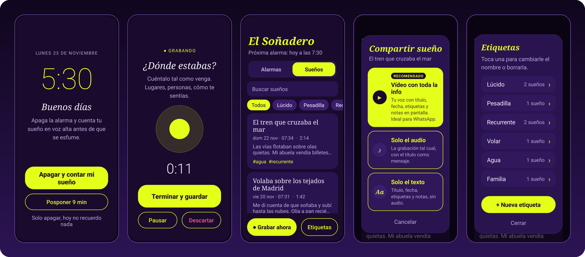

<b>El despertador que te deja contar tus sueños antes de que se esfumen.</b> 
Al apagar la alarma, El Soñadero empieza a grabar. Tú solo hablas.

<a href="El%20Soñadero%20-%20presentación.mp4"><b>▶ Ver el vídeo de presentación</b></a> (1 minuto)

---

## Instálala en tu móvil

<table>
<tr>
<td width="46%" align="center">

</td>
<td>

**1. Escanea el código** con la cámara del móvil, o toca el botón:

**2. Abre el archivo descargado** desde la notificación o desde la carpeta *Descargas*.

**3. Toca «Instalar».** Si el móvil avisa de que es una app de fuera de Play Store, toca *Ajustes* y activa *Permitir desde esta fuente*. Solo hay que hacerlo una vez.

</td>
</tr>
</table>

> Funciona en móviles **Android** (versión 8 o posterior). No está disponible para iPhone.

## La primera vez que la abras

El Soñadero te pedirá dos permisos. Acepta los dos:

- **Micrófono**, para grabar tus sueños.
- **Notificaciones**, para que la alarma pueda sonar.

Si en la pantalla principal aparece un **aviso amarillo**, tócalo y activa lo que te indique. Normalmente es *«pantalla completa»*, que hace que la alarma aparezca aunque el móvil esté bloqueado.

## Cómo se usa

**1. Pon tu alarma.** Toca *+ Nueva alarma*, elige la hora y los días, y si quieres escribe un mensaje para despertarte.

**2. Al sonar, toca «Apagar y contar mi sueño».** Empieza a grabar al momento, incluso con el móvil bloqueado. Cuéntalo tal como venga: la pantalla te irá haciendo preguntas (*¿Dónde estabas? ¿Quién aparecía?*) para ayudarte a recordar. Cuando acabes, toca *Terminar y guardar*.

> ¿No te acuerdas de nada? Toca *Solo apagar*. ¿Cinco minutos más? Toca *Posponer 9 min*.

**3. Revive tus sueños en la pestaña «Sueños».** Ahí están todos, del más reciente al más antiguo. Busca por palabras o toca una etiqueta para ver solo esos sueños.

**4. Ponles nombre y etiquetas.** Toca un sueño para escucharlo, cambiarle el título, escribir notas y marcar etiquetas como *Lúcido*, *Pesadilla* o *Volar*. Toca *+ Nueva* para crear las tuyas, o *Etiquetas* para renombrarlas o borrarlas.

**5. Compártelo.** En la ficha del sueño toca *Compartir sueño* y elige:

- **Vídeo con toda la info**: tu voz con el título, la fecha, las etiquetas y las notas en pantalla. Se ve y se oye directamente en WhatsApp, Telegram o donde quieras.
- **Solo el audio**: la grabación tal cual.
- **Solo el texto**: título, fecha, etiquetas y notas, para pegarlo en un chat.

**¿Te ha venido un sueño a la cabeza durante el día?** Toca *Grabar ahora* en la pestaña *Sueños*.

## Preguntas frecuentes

<b>¿Dónde se guardan mis sueños? ¿Alguien más puede oírlos?</b>

 
Solo en tu móvil. El Soñadero no usa internet ni envía nada a ningún sitio: un sueño solo sale del móvil si tú lo compartes. Si desinstalas la app, las grabaciones se borran.

<b>La alarma no ha sonado o solo apareció una notificación</b>

 
Abre El Soñadero y toca el aviso amarillo si aparece. En algunos móviles (Xiaomi, OPPO, OnePlus, Samsung…) conviene ir a <i>Ajustes → Batería → El Soñadero</i> y elegir <i>Sin restricciones</i> o <i>Permitir actividad en segundo plano</i>.

<b>¿Qué pasa si se apaga la pantalla mientras grabo?</b>

 
No se pierde nada: lo que llevabas grabado se guarda solo.

<b>¿Cómo la actualizo a una versión nueva?</b>

 
Escanea el mismo código QR y vuelve a instalar. Tus sueños y alarmas se conservan.

## Colores

Púrpura de noche con amarillo fosforito, como una luciérnaga en la oscuridad.

---

Para desarrolladores

 

Código en `ElSoniadero/`: app Android nativa en Java, sin dependencias externas. Se abre directamente con Android Studio (*File → Open* → carpeta `ElSoniadero`) y se ejecuta con el botón ▶.

