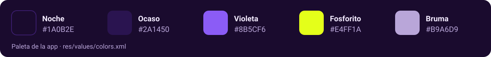

<p align="center"></p>

Despertador y grabadora de sueños para Android. Al apagar la alarma empieza a grabar al instante, para que puedas contar tu sueño antes de que se esfume, y guarda cada grabación en un diario con títulos, notas y etiquetas.

<p align="center"></p>

<p align="center"><a href="El%20Soñadero%20-%20presentación.mp4"><b>▶ Ver el vídeo de presentación</b></a> · 58 s, capturas reales</p>

## Qué hace

- **Alarmas** con hora, días de repetición y un mensaje opcional. Suenan aunque el móvil esté bloqueado, con volumen creciente y vibración. Posponer 9 minutos.
- **Grabación automática** al pulsar «Apagar y contar mi sueño»: pantalla oscura sobre el bloqueo, círculo que late con la voz y preguntas que van cambiando («¿Dónde estabas?», «¿Quién aparecía?»…). Se puede pausar, guardar o descartar. Si la pantalla se cierra a mitad, lo grabado se guarda igualmente.
- **Diario de sueños**: lista por fecha, búsqueda en títulos, notas y etiquetas, y filtros por etiqueta. «Grabar ahora» para grabar sin alarma.
- **Ficha de cada sueño**: reproductor con barra de avance, título, notas y etiquetas.
- **Etiquetas editables**: crear, renombrar (se actualiza en todos los sueños) y borrar.

Las grabaciones se guardan solo en el móvil, en el almacenamiento privado de la app.

## Colores

Púrpura de noche con amarillo fosforito, como una luciérnaga en la oscuridad.

<p align="center"></p>

## Compilar e instalar

Requisitos: Android Studio (o JDK 17+ y el Android SDK con la plataforma 34).

```powershell
cd ElSonadero
.\gradlew.bat assembleDebug
adb install -r app\build\outputs\apk\debug\app-debug.apk
```

Android 8.0 o superior. La primera vez pide permiso de micrófono y notificaciones. En Android 14+, si la app muestra un aviso de «pantalla completa», actívalo para que la alarma aparezca con el móvil bloqueado.

## Estructura

- `ElSonadero/app/src/main/java/com/elsonadero/app/`
  - `AlarmStore`, `AlarmScheduler`, `AlarmReceiver`, `BootReceiver`: alarmas y su programación con `AlarmManager.setAlarmClock`.
  - `AlarmService`: hace sonar la alarma y muestra la notificación de pantalla completa.
  - `RingActivity`: pantalla de despertar.
  - `RecordActivity`: grabadora (AAC, `.m4a`).
  - `DreamStore`: sueños y etiquetas en un JSON privado.
  - `MainActivity`, `DreamDetailActivity`, `Ui`, `FlowLayout`: interfaz.

Java y vistas nativas de Android, sin dependencias externas.
